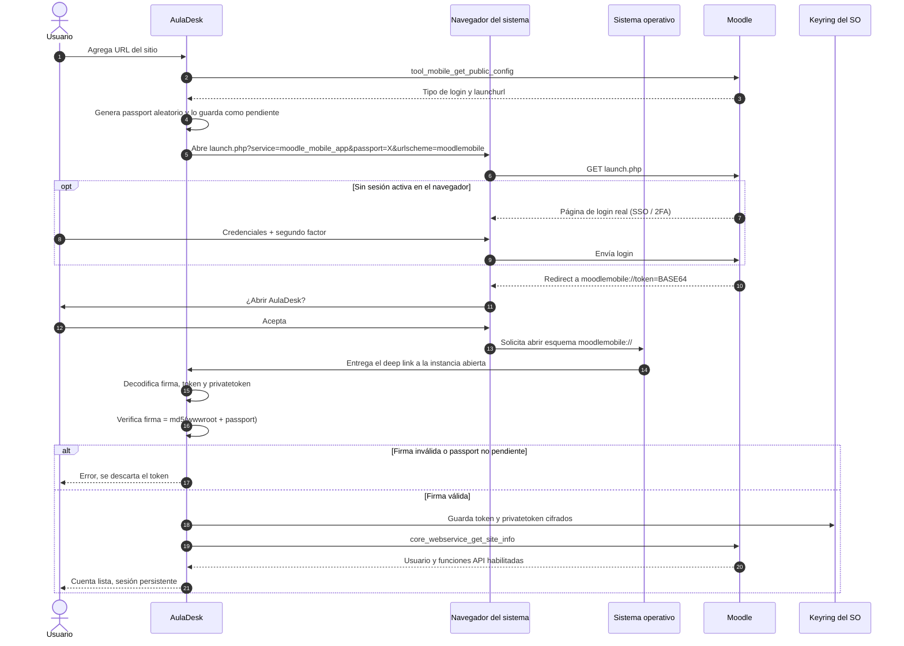

# Login

Flujo de login de AulaDesk ([D-13 a D-15](../registro-de-decisiones.md#55-login-y-sesión)). El usuario se autentica en el navegador del sistema, así que AulaDesk nunca ve la contraseña ni el segundo factor, y el token llega a la app por deep link.

## Notas

- **Login opcional (pasos 7 a 9):** si el navegador ya tiene una sesión activa en Moodle, el redirect llega sin pedir credenciales.
- **Instancia única (paso 14):** si AulaDesk ya está abierta, el sistema operativo entrega el deep link a esa instancia en lugar de iniciar otra.
- **Firma (paso 16):** `wwwroot` es la URL del sitio sin `/` final. La firma y el passport pendiente impiden aceptar un enlace `moodlemobile://` que no provenga de un login iniciado por AulaDesk.
- **`privatetoken` (paso 18):** se guarda desde la fase 1 porque permite pedir las claves de autologin para abrir el sitio real ya autenticado ([D-15](../registro-de-decisiones.md#55-login-y-sesión)).
